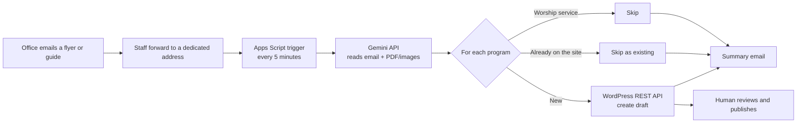

[README.md](https://github.com/user-attachments/files/33415554/README.md)
# Email to WP

An AI automation that turns emailed event flyers and seasonal program guides into WordPress drafts.

A church office sends event information in whatever format is handy: a poster PDF, a 16-page program guide, an image, or a short email. Staff forward that email to one address. A few minutes later, ready-to-review WordPress drafts appear, along with a summary email listing what was created, what already exists, and what was skipped.

## The problem

Every new program on the website used to be entered by hand: title, description, dates, time, location, cost, category, and frequency. That took **15 to 25 minutes per post**, and a single seasonal guide can contain 20+ programs.

The office staff are not technical, so asking them to fill in a form or a spreadsheet was not an option. The tool had to accept information exactly the way they already send it.

## How it works

1. **Find new requests**: a time-driven trigger searches Gmail for forwarded emails that have not been processed yet.
2. **Extract**: the email body and attachments (PDF, images) are sent to the Gemini API, which returns structured JSON. One flyer becomes one event; a seasonal guide becomes many.
3. **Filter**: worship services are skipped, and each program is compared against existing website posts to avoid duplicates.
4. **Create drafts**: new programs become WordPress drafts with custom fields (ACF), category, and frequency filled in.
5. **Report**: a summary email lists new drafts (with edit links and missing-field warnings), existing matches, and skipped items.
6. **Mark as done**: the email gets a label so it is never processed twice.

## Design decisions

**AI extraction instead of rule-based parsing.**
Incoming material has no fixed format. Many flyers are exported as images, so there is no text to parse at all. An LLM reads them the way a person would.

**Drafts only, never auto-publish.**
A human reviews every post before it goes live. The tool removes the repetitive data entry, not the judgment.

**Never invent facts.**
Dates, times, locations, and costs are only filled in when they appear in the source. If something is missing, the field stays empty and the draft gets a visible warning, so a wrong date never reaches the public site.

**Explicit defaults.**
When no location or cost is given, the tool uses safe defaults (the main address, "Free") and marks them as defaults in the warning, so the reviewer knows which values came from the source and which did not.

**Duplicate detection by meaning, not by string match.**
Post titles are often rewritten for SEO, so "Choir Practices" in a guide may be "Join the Choir" on the website. Instead of comparing strings, the list of existing titles is sent to the model, which identifies programs that are the same even under a different name. Drafts count as existing too, so forwarding the same guide twice does not create duplicates.

**Google Apps Script instead of a Node server.**
The organization already runs on Google Workspace. Apps Script runs on Google's servers for free, has built-in Gmail access and scheduled triggers, and stays inside the organization's account, so a successor can take it over without any hosting. The trade-off is weaker tooling: no TypeScript, no npm packages, and a 6-minute execution limit.

**Email notifications instead of Slack.**
The office works in email, not chat. Notifications go where people already look. Sending is isolated in a single `notify()` function, so switching to Slack or another channel only touches one place.

## Reliability

- **Idempotent processing**: a Gmail label marks each handled email. If a run fails partway, the label is not applied and the next run retries automatically.
- **Retries**: on `503` or `429` from the AI API, the request is retried up to 3 times with a 15-second wait.
- **Quiet when idle**: if there are no new emails, the run exits in about a second and sends nothing.
- **Validation of taxonomy values**: categories and frequencies are mapped to WordPress term IDs; an unexpected value from the model becomes a warning instead of a broken post.

## Results

| Test | Result |
|---|---|
| Single event poster (image PDF) | All fields correct, including a registration deadline found in the artwork |
| 16-page seasonal program guide | 27 programs extracted in about 16 seconds |
| Mixed 5-item test guide | 3 new drafts, 1 existing match (different title), 1 worship service skipped, as expected |
| End-to-end with trigger | Draft and summary email within 5 minutes of forwarding, no manual run |

Time saved per post: **to be measured** against the 15 to 25 minute manual baseline.

## Tech stack

- Google Apps Script (JavaScript)
- Gemini API (structured JSON output, PDF and image input)
- WordPress REST API with Application Passwords
- Advanced Custom Fields (ACF) and custom taxonomies
- Gmail (input, labels, notifications)

## Setup

1. Create an Apps Script project in the Google account that receives requests.
2. Add these **Script Properties** (Project Settings). Secrets are never stored in code.
   - `WP_USERNAME`: a WordPress user with Editor role
   - `WP_APP_PASSWORD`: an Application Password for that user
   - `GEMINI_API_KEY`: from Google AI Studio
3. Make sure the event post type, ACF field group, and taxonomies are exposed to the REST API.
4. Update the category and frequency term IDs to match the site.
5. Add a time-driven trigger for `processRequests` (every 5 minutes).
6. Forward a test email to the request address and check the summary email.

## Limitations and next steps

- Word (.docx) attachments are not read yet; they need to be converted to PDF first.
- Events that have already ended should be skipped automatically.
- The warning line lives in the post body; it should move to an admin-only field.
- Configuration (addresses, term IDs, contact info) should move into a single config file.
- AI output should be validated against a schema before posting.
- Compare Gemini and Claude on the same test set for accuracy, cost, and speed.
